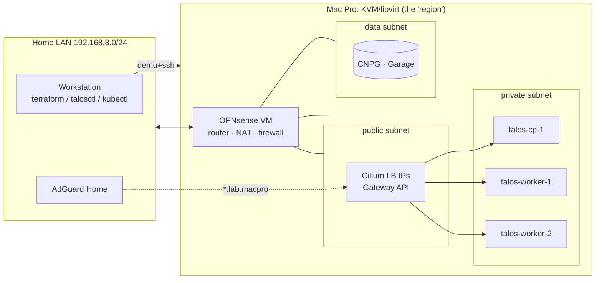

# homelab-cloud

A production-shaped **AWS-like platform** built entirely as code on one Mac Pro (Late 2013):
VPC → "EKS" → managed-service equivalents → GitOps CI/CD → DevSecOps tooling, plus AWS-provider Terraform
modules tested against the AWS Emulator.

> Status: **Phase 1**: VPC (3 subnets) + OPNsense router/NAT/firewall + test VM, fully rebuildable
> with `make destroy && make up` (~90 s). See [ADR 0003](docs/decisions/0003-vpc-networking.md).

## Architecture (target)



| AWS | Here |
|---|---|
| EC2 / VPC | KVM + libvirt, OPNsense |
| EKS | Talos Linux + Cilium |
| S3 / RDS / ECR | Garage / CloudNativePG / Harbor |
| IAM / Secrets Manager | Keycloak / OpenBao + External Secrets |
| CodePipeline / CodeDeploy | Forgejo Actions / Argo CD + Rollouts |
| CloudWatch | kube-prometheus-stack + Loki |
| Security (CNAPP, EDR, SCPs) | Trivy Operator, Kubescape, Falco, Wazuh, Kyverno, DefectDojo |

## Usage

```sh
make help     # list targets
make hooks    # install pinned tools + git hooks
make lint     # pre-commit on all files
make temps    # host CPU temperatures
make up       # build the lab (images, networks, OPNsense, test VM)
make route    # sudo: route 10.10.0.0/16 via OPNsense on this workstation
make verify   # acceptance checks
make destroy  # tear it down
```

Manual one-time steps: [docs/bootstrap.md](docs/bootstrap.md). Design decisions: [docs/decisions/](docs/decisions/).

## Layout

```
terraform/host   libvirt networks, pools, VMs        k8s/bootstrap  Argo CD + root app
terraform/talos  Talos machine configs / bootstrap   k8s/platform   managed-service equivalents
terraform/aws    real-AWS-shaped modules             k8s/security   policy, runtime, posture
apps/            sample service(s)                   .forgejo/      CI pipelines
```
